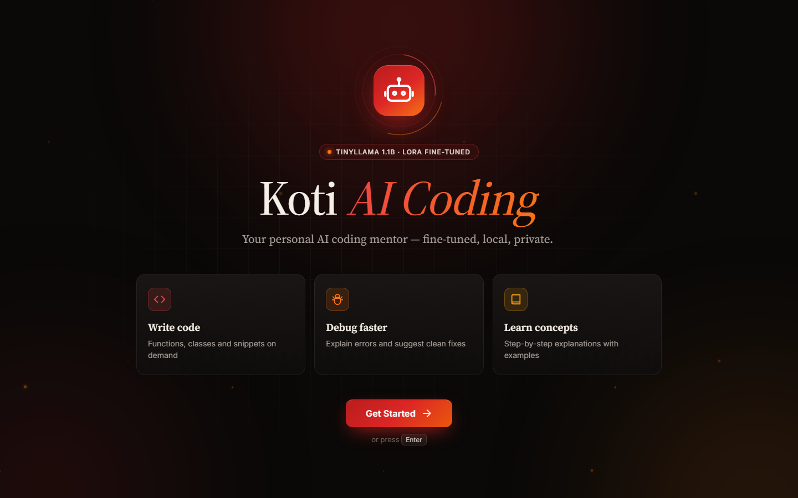
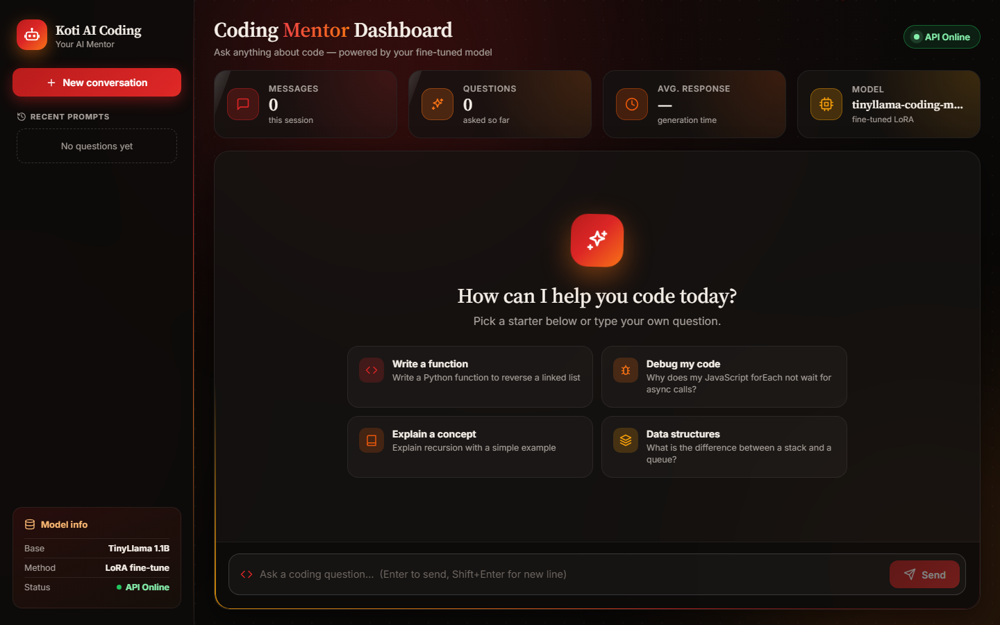

# Koti AI Coding

**A local AI coding mentor powered by a LoRA fine-tuned TinyLlama-1.1B model, served by FastAPI and used through a React dashboard.**

Koti AI Coding answers programming questions, writes code snippets, explains concepts and helps you debug — running entirely on your own machine (CPU only, no GPU or cloud API needed).





---

## Features

- **Fine-tuned model** – [TinyLlama-1.1B-Chat](https://huggingface.co/TinyLlama/TinyLlama-1.1B-Chat-v1.0) with a LoRA adapter (PEFT) trained on coding Q&A.
- **Streaming answers** – tokens appear live as the model generates them (`/ask/stream`).
- **Fast on CPU** – LoRA weights are merged and the model is int8 dynamically quantized at startup.
- **Instant small talk** – greetings like *"hi, how are you"* get short replies without running the model.
- **Follow-up questions** – recent chat history is sent so the model keeps context.
- **Polished UI** – black / red / orange theme with an animated intro page, stats cards, Markdown-rendered answers with styled code blocks, copy buttons and a stop button.

## Tech stack

| Layer      | Tools                                                    |
|------------|----------------------------------------------------------|
| Model      | TinyLlama-1.1B-Chat, LoRA (PEFT), Hugging Face Transformers, PyTorch |
| Backend    | FastAPI, Uvicorn                                          |
| Frontend   | React (Create React App), react-markdown                  |

## Project structure

```
├── api.py                    # FastAPI server: loads model + adapter, /ask and /ask/stream
├── prompts.py                # Shared system prompt
├── build_dataset.py          # Builds train_dataset.jsonl (166 chat examples, 75 topics)
├── train_dataset.jsonl       # Chat-format training data
├── train_phi2.py             # Original LoRA training script
├── generate_dataset.py       # Original small dataset generator
├── tinyllama-coding-model/   # Trained LoRA adapter
├── frontend/coding-ai-ui/    # React dashboard (intro page + chat dashboard)
├── start.bat / start.js      # One-click launcher for API + web UI
└── docs/                     # Screenshots
```

## Getting started

### 1. Backend (API)

```powershell
python -m venv venv
venv\Scripts\activate                     # macOS/Linux: source venv/bin/activate
pip install torch transformers peft fastapi uvicorn datasets accelerate
uvicorn api:app --reload
```

The first run downloads the TinyLlama base model (~2.2 GB) from Hugging Face. The API runs on **http://127.0.0.1:8000** (interactive docs at `/docs`).

### 2. Frontend (dashboard)

```powershell
cd frontend/coding-ai-ui
npm install
npm start
```

Open **http://localhost:3000** — the intro page appears first; click **Get Started** (or open `http://localhost:3000/#app` to go straight to the dashboard).

### One-click start (Windows)

Double-click **`start.bat`** to open the API and the web UI in two windows.

## API

| Method | Endpoint       | Body                                   | Returns                 |
|--------|----------------|----------------------------------------|-------------------------|
| GET    | `/`            | –                                      | Health + model info     |
| POST   | `/ask`         | `{"prompt": "...", "history": [...]}`  | `{"response": "..."}`   |
| POST   | `/ask/stream`  | same as `/ask`                         | Streamed plain text     |

### Configuration (environment variables)

| Variable          | Default | Description                                 |
|-------------------|---------|---------------------------------------------|
| `MAX_NEW_TOKENS`  | `384`   | Maximum answer length                       |
| `QUANTIZE`        | `1`     | `0` disables int8 quantization (slower, fp32) |
| `USE_ADAPTER`     | `1`     | `0` uses the plain base model               |
| `ADAPTER_PATH`    | auto    | Folder of the LoRA adapter to load          |

## Fine-tuning

The adapter in `tinyllama-coding-model/` was trained with LoRA (`r=8`, `alpha=16`, targets `q_proj`, `v_proj`) using `train_phi2.py`.
`build_dataset.py` generates a larger chat-format dataset (`train_dataset.jsonl`) that can be used to retrain the adapter with the same system prompt as the API (`prompts.py`).

## Limitations

- TinyLlama is a small 1.1B-parameter model: answers are helpful for common programming questions but can be wrong on complex ones — always check generated code.
- On CPU, long answers take several seconds to generate; a GPU makes it much faster.

## License

For educational and personal use.
